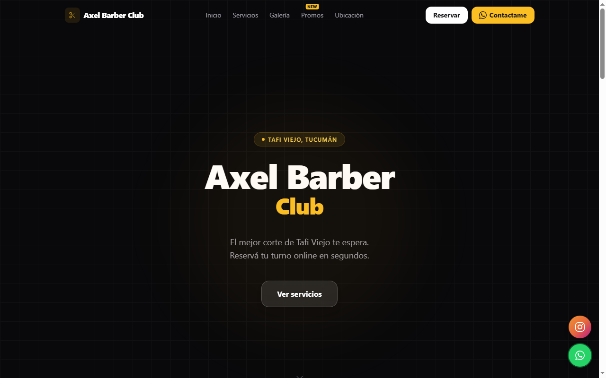

# BarberApp


A production-ready, multi-tenant barbershop booking PWA built with Next.js 14, Supabase, and Tailwind CSS. Designed for small barbershops in Argentina: mobile-first, installable as a PWA, with a full admin panel, loyalty rewards system, and hardened security posture.

> **Live demo:** [axelbarber.vercel.app](https://axelbarber.vercel.app)



---

## Features

### Client-facing
- **Online booking flow** — service selection → date/time picker → client registration → confirmation
- **Real-time slot availability** — prevents double-booking at the DB level via partial unique indexes
- **Loyalty rewards** — automatic discount (15% off) at every 3rd cut, free cut at every 6th; configurable per tenant
- **QR confirmation** — each completed cut generates a QR receipt

### Admin panel (`/dashboard`)
- Live appointment queue with confirm / complete / cancel / no-show actions
- Full client directory with loyalty history per client
- Analytics dashboard: daily stats, period comparison, revenue tracking (Recharts)
- CSV export of cut history with date-range filtering
- Blocked dates management (holidays, vacations)
- Configurable business settings: hours, working days, services, loyalty thresholds

### Platform
- **PWA** — installable on iOS and Android via Serwist (Workbox-based service worker)
- **Multi-tenant ready** — all tables are scoped by `tenant_id`; designed to onboard multiple barbershops
- **Dark mode** — system-aware via `next-themes`
- **i18n-ready** — UI copy in Spanish (Argentina), dates/times in `America/Argentina/Buenos_Aires`

---

## Tech Stack

| Layer | Technology |
|---|---|
| Framework | [Next.js 14](https://nextjs.org) — App Router, Server Components, Route Handlers |
| Language | TypeScript 5 (strict mode) |
| Database | [Supabase](https://supabase.com) (PostgreSQL 15) |
| Auth | Supabase Auth (email/password) |
| Styling | Tailwind CSS 3 |
| Charts | Recharts |
| PWA | Serwist (`@serwist/next`) |
| QR codes | `qrcode` |
| Phone validation | `libphonenumber-js` |
| Excel export | `xlsx` |
| Deployment | [Vercel](https://vercel.com) |
| Testing | Jest + ts-jest |

---

## Architecture

```
app/
├── (admin)/              # Route group — requires authenticated admin session
│   ├── dashboard/        # Live appointment queue
│   ├── turnos/           # Full appointments list
│   ├── clientes/         # Client directory
│   ├── ajustes/          # Settings (hours, services, loyalty, blocked dates)
│   └── layout.tsx        # Auth gate: session check + ADMIN_EMAIL guard
├── api/
│   ├── bookings/         # POST — public booking creation (rate-limited)
│   ├── slots/            # GET — available slots via get_available_slots RPC
│   ├── services/         # GET — active services for the booking flow
│   └── admin/            # Admin-only routes (session-protected)
│       ├── appointments/ # CRUD + status transitions
│       ├── clients/      # Client management
│       ├── stats/        # Analytics endpoints
│       ├── export/       # CSV export with date-range + pagination cap
│       └── blocked-dates/# Holiday / vacation management
├── book/                 # Public multi-step booking UI
├── login/                # Admin login
└── confirmation/         # Booking confirmation page

lib/
├── supabase/             # Server + client Supabase instances (SSR-safe)
└── tenant.ts             # TENANT_ID resolution (server-only env var)

middleware.ts             # Session validation, admin route protection, CSRF check, rate limiting

supabase/migrations/      # 20 sequential SQL migrations (full schema history)
```

### Key design decisions

**Server-only tenant resolution** — `TENANT_ID` is a server-side env var. The public `NEXT_PUBLIC_TENANT_ID` fallback exists only for local dev. The UUID never leaks to the browser in production.

**All writes go through service_role** — No Supabase anon key is used for mutations. Every API route uses the `SUPABASE_SERVICE_ROLE_KEY`. RLS policies on the anon role are either `false` or dropped entirely.

**Atomic cut completion** — `complete_cut(booking_id, tenant_id)` is a single PL/pgSQL function that locks the booking row, calculates loyalty state, writes to `cuts`, appends to `loyalty_ledger`, and marks the booking `completed` — all in one transaction. No partial states.

---

## Database Schema

20 migrations define the full schema. Key tables:

| Table | Purpose |
|---|---|
| `tenants` | One row per barbershop; stores settings (hours, available days) as JSONB |
| `services` | Menu of services with price and duration |
| `clients` | Registered clients (name, phone, email) |
| `bookings` | Every appointment; partial unique indexes prevent double-booking |
| `cuts` | Immutable record of completed services (financial audit trail) |
| `loyalty_config` | Per-tenant reward thresholds (discount_at, free_at, discount_pct) |
| `loyalty_ledger` | Append-only event log driving the loyalty counter |
| `blocked_dates` | Dates unavailable for booking (holidays, vacations) |

### RPC functions

| Function | Caller | Notes |
|---|---|---|
| `get_available_slots(tenant_id, date)` | `service_role` only | `SECURITY INVOKER` — returns empty for unauthorized callers |
| `complete_cut(booking_id, tenant_id)` | `service_role` only | `SECURITY DEFINER`, locked `search_path`, REVOKED from `PUBLIC` |

### Analytics views

`daily_stats`, `weekly_stats`, `monthly_stats`, `low_traffic_slots` — all recreated with `WITH (security_invoker = true)` (PostgreSQL 15) to prevent privilege escalation through SECURITY DEFINER view bypass.

---

## Security

This project went through a full security audit. Measures implemented:

### Authentication & Authorization
- Admin routes protected by Supabase session check in `middleware.ts`
- `ADMIN_EMAIL` env var enforces a single authorized admin — any authenticated user without this email is redirected to `/login`
- All admin API routes verify session server-side before any DB access

### API hardening
- **CSRF protection** — Origin header validated against `NEXT_PUBLIC_APP_URL` on all non-safe HTTP methods to `/api/admin/*`
- **Rate limiting** — In-memory sliding window on `POST /api/bookings`: 5 requests/minute/IP
- **Input validation** — Date params validated with regex before hitting the DB; no raw user input passed to queries

### Supabase / PostgreSQL
- RLS enabled on all tables; anon policies are either `USING (false)` or dropped
- `complete_cut` REVOKED from `PUBLIC` and `anon`; granted only to `service_role`
- `get_available_slots` runs as `SECURITY INVOKER` — unauthenticated PostgREST calls return empty results
- All SECURITY DEFINER functions use `SET search_path = public` to prevent schema injection
- All analytics views use `WITH (security_invoker = true)`
- Dropped always-true RLS policies on `bookings` that would have allowed anon inserts/selects without tenant scope

### Error handling
- Generic error messages returned to clients — no stack traces, constraint names, or internal DB details leak to the browser
- Specific constraint violations (`uniq_active_booking_per_client`, `uniq_slot_per_tenant`) mapped to user-friendly Spanish messages

---

## Environment Variables

Create a `.env.local` for local development:

```env
# Supabase
NEXT_PUBLIC_SUPABASE_URL=https://your-project.supabase.co
NEXT_PUBLIC_SUPABASE_ANON_KEY=your-anon-key
SUPABASE_SERVICE_ROLE_KEY=your-service-role-key

# Tenant
# Server-only in production — NEVER expose the real UUID via NEXT_PUBLIC_ in prod
TENANT_ID=your-tenant-uuid
NEXT_PUBLIC_TENANT_ID=your-tenant-uuid   # local dev only

# Admin
ADMIN_EMAIL=your-admin@email.com

# App URL (used for CSRF origin validation)
NEXT_PUBLIC_APP_URL=http://localhost:3000
```

> **Warning:** `SUPABASE_SERVICE_ROLE_KEY` bypasses RLS. Never expose it client-side. It must remain server-only.

---

## Getting Started

### Prerequisites
- Node.js 20+
- A [Supabase](https://supabase.com) project (free tier works)

### Setup

```bash
# 1. Clone
git clone https://github.com/AGonzalez-97/BarberApp.git
cd BarberApp

# 2. Install dependencies
npm install

# 3. Set up environment variables
cp .env.example .env.local
# Fill in your Supabase credentials and tenant UUID

# 4. Apply migrations (run each file in order in the Supabase SQL Editor)
# supabase/migrations/20240001_tenants.sql → 20240020_revoke_slots_public.sql

# 5. Run the development server
npm run dev
```

Open [http://localhost:3000](http://localhost:3000) for the booking flow.
Admin panel: [http://localhost:3000/dashboard](http://localhost:3000/dashboard)

### Running tests

```bash
npm test
npm run test:watch
```

---

## Deployment

The project is deployed on Vercel with automatic production deploys from `master`.

### Vercel environment variables

Set the following in your Vercel project settings (Settings → Environment Variables):

| Variable | Environment |
|---|---|
| `NEXT_PUBLIC_SUPABASE_URL` | Production, Preview, Development |
| `NEXT_PUBLIC_SUPABASE_ANON_KEY` | Production, Preview, Development |
| `SUPABASE_SERVICE_ROLE_KEY` | Production, Preview |
| `TENANT_ID` | Production, Preview |
| `ADMIN_EMAIL` | Production, Preview |
| `NEXT_PUBLIC_APP_URL` | Production (`https://axelbarber.vercel.app`) |

### Manual deploy

```bash
npm i -g vercel
vercel --prod
```

---

## PWA

The app is installable as a Progressive Web App on iOS and Android.

- Service worker powered by [Serwist](https://serwist.pages.dev) (successor to `next-pwa`)
- Manifest configured in `app/manifest.ts`
- iOS install banner shown automatically on first visit via `IOSInstallBanner` component
- Offline support for static assets; API calls gracefully degrade when offline

---

## Multi-tenancy

The schema is fully multi-tenant from day one. Every table includes `tenant_id uuid NOT NULL` and RLS policies scope all reads/writes to the authenticated tenant. To onboard a new barbershop:

1. Insert a row in the `tenants` table with the shop's settings
2. Seed `services`, `loyalty_config` for the new tenant
3. Create a Supabase Auth user and set `ADMIN_EMAIL` to their address
4. Deploy a separate Vercel project (or use the same one with a different `TENANT_ID` env var)

---

## Project Structure

```
BarberApp/
├── app/                    # Next.js App Router
├── components/             # React components
│   ├── admin/              # Admin panel components
│   ├── booking/            # Multi-step booking flow components
│   └── ui/                 # Shared UI primitives
├── lib/                    # Utilities and Supabase clients
├── public/                 # Static assets, PWA icons
├── supabase/
│   └── migrations/         # 20 SQL migrations — full schema history
├── middleware.ts            # Auth, CSRF, rate limiting
└── tailwind.config.ts
```

---

## License

Private — all rights reserved.
